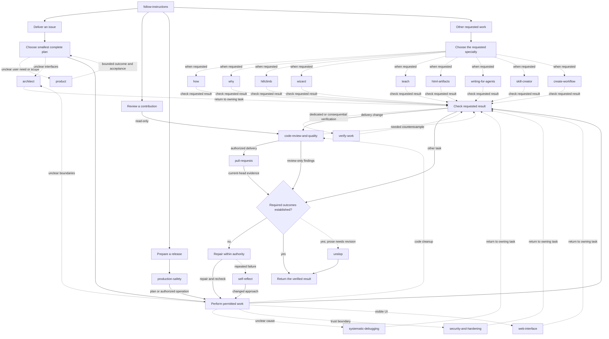

# Astatide Skills

Skills for agents that develop, review and maintain software. Start with
`follow-instructions` for substantial engineering work, or choose a skill below
for a specific task.

## Install

```sh
git clone --branch main --single-branch https://github.com/Astatide1337/Skills.git
cd Skills
./scripts/install.sh --list
./scripts/install.sh --all --target ~/.agents/skills
```

Use `~/.claude/skills` for Claude Code or `~/.config/opencode/skills` for OpenCode.
The legacy Codex path `~/.codex/skills` is also supported. Always choose the target
explicitly. Installation replaces selected packages, including local edits.

To install only selected skills:

```sh
./scripts/install.sh --target ~/.agents/skills \
  --skill systematic-debugging --skill web-interface
```

The installer copies local files; it does not fetch sources or execute bundled
scripts. It includes required helpers and refuses incompatible existing ones
unless you select them for replacement too.

## Use

Give the agent the task and any restrictions:

```text
Fix the search filter and verify the regression. Keep this local.
Review this PR for correctness and security. Do not change the code.
Implement the approved plan, resolve review findings and finish CI.
```

`follow-instructions` selects the procedure and loads other skills as needed.
Clear local corrections use a short path. Ordinary plans stay in the task
record; a separate approval artifact is needed only when the user or project
requires one.

The [global instructions](global-instructions/AGENTS.md) include personal defaults
for PR delivery and environment access. Installing skills does not install those
instructions. Review them before choosing to use them. Under those defaults,
implementation includes a scoped PR unless restricted, merging needs explicit
approval, auto-merge is prohibited, and deployment requires preparation, verification and
explicit final approval.

Delegation follows the [model-selection policy](skills/follow-instructions/references/agent-selection.md).
It chooses from available models and reasoning options, honors explicit user
choices, and records the actual settings. One agent owns integration; independent
reviewers inspect the resulting change.

## Workflow map

`follow-instructions` selects a route; it does not run every skill. Solid arrows
show continuation. Dashed arrows attach expertise only when its trigger applies.
Skill names link to their owners in the table below.



Review-only work returns findings without edits or publication. Release work
uses the owning runbook and existing authority; a plan does not authorize a
deployment. Failed requirements return to repair, while repeated failed
approaches use `self-reflect`. Clear local tasks use direct checks; `verify-work`
and `unslop` apply when their triggers fit the task. Prose cleanup cannot turn
missing evidence into a pass.

## Skills

| Skill | Use it to |
| --- | --- |
| [follow-instructions](skills/follow-instructions/SKILL.md) | Select a workflow and carry the task through completion. |
| [product](skills/product/SKILL.md) | Define the user problem, smallest useful scope and acceptance. |
| [architect](skills/architect/SKILL.md) | Design interfaces, ownership and state from real callers. |
| [systematic-debugging](skills/systematic-debugging/SKILL.md) | Reproduce a failure, find its cause and verify the fix. |
| [code-review-and-quality](skills/code-review-and-quality/SKILL.md) | Review code, run independent rounds and remove unnecessary code. |
| [pull-requests](skills/pull-requests/SKILL.md) | Draft, open, review or monitor PRs and MRs. |
| [verify-work](skills/verify-work/SKILL.md) | Verify claims and build project-specific checkers. |
| [security-and-hardening](skills/security-and-hardening/SKILL.md) | Find and repair reachable security failures. |
| [production-safety](skills/production-safety/SKILL.md) | Check targets, permissions and recovery before operational changes. |
| [web-interface](skills/web-interface/SKILL.md) | Build and review usable, accessible web interfaces. |
| [html-artifacts](skills/html-artifacts/SKILL.md) | Create a standalone HTML report, diagram or interactive explanation. |
| [hillclimb](skills/hillclimb/SKILL.md) | Improve a measured result through controlled experiments. |
| [how](skills/how/SKILL.md) | Trace how code works. |
| [why](skills/why/SKILL.md) | Find why a design or implementation was chosen. |
| [teach](skills/teach/SKILL.md) | Explain code so the reader can maintain it. |
| [unslop](skills/unslop/SKILL.md) | Write or revise clear prose without changing its meaning. |
| [writing-for-agents](skills/writing-for-agents/SKILL.md) | Write actionable agent instructions and runbooks. |
| [skill-creator](skills/skill-creator/SKILL.md) | Create, revise and evaluate skills. |
| [create-workflow](skills/create-workflow/SKILL.md) | Automate a recurring procedure. |
| [self-reflect](skills/self-reflect/SKILL.md) | Recover from repeated failure and propose reusable fixes. |
| [wizard](skills/wizard/SKILL.md) | Build an interactive setup script. |

## Update existing installations

Fetch and review the desired revision, then preview a sync with the supported
Python interpreter:

```sh
python3 scripts/sync.py --ref HEAD --target ~/.agents/skills
```

Add `--apply` to make the changes. Repeat `--target` for other installations.
Sync updates only catalog packages already present, backs up local changes and
restores them if a write fails. Unrelated skills remain untouched. Restart agent
sessions after updating.

When upgrading from a catalog with `grilling`, `deslop` or `better-call-sol`,
install the replacement owners first, then retire the old packages:

```sh
./scripts/install.sh --skill product --skill code-review-and-quality --target ~/.agents/skills
./scripts/install.sh --retire grilling --target ~/.agents/skills
./scripts/install.sh --retire deslop --target ~/.agents/skills
./scripts/install.sh --retire better-call-sol --target ~/.agents/skills
```

Retirement removes only a known, unchanged package. Customized copies are
preserved for manual review. Sync alone does not remove retired skills or add
new ones.

Optional sync settings:

- `--claude-settings ~/.claude/settings.json` installs versioned hooks without
  replacing unrelated settings. Read the [hook guide](global-instructions/hooks/README.md)
  before enabling them; local hooks have retry limits and failure modes.
- `--instructions /path/to/rules.md ~/.codex/AGENTS.md` updates a `skills-sync`
  block while preserving text outside it. Use your own rules when the catalog
  owner's personal defaults do not apply.

## Maintain

Keep reusable instructions in `skills/`, source attribution in
[`catalog.yaml`](catalog.yaml), and regression cases and tests in `evals/`.
One-off research, audit reports, experiment output and PR progress belong in
working artifacts or the PR, not the installed catalog. Existing history is
available in Git.

Use the runtime versions declared in [`pyproject.toml`](pyproject.toml),
[the CI workflow](.github/workflows/ci.yml) and the locked dependencies. The checks also
require Bubblewrap with user namespaces enabled:

```sh
uv sync --frozen
uv run --frozen python skills/code-review-and-quality/scripts/setup_portable_lint.py --runtime /path/to/skills-lint
export SKILLS_LINT_RUNTIME=/path/to/skills-lint
make verify
```

Use a fresh directory outside the checkout for the lint runtime. For structural
checks alone, run `./scripts/validate-skills.sh`.

For a skill change, follow [skill-creator](skills/skill-creator/SKILL.md).
For live comparisons, use its [evaluation procedure](skills/skill-creator/references/evaluation.md)
and the existing Inspect tasks. Tests and successful installation do not by
themselves demonstrate better agent behavior.

Review rules live in [AGENTS.md](AGENTS.md); `CLAUDE.md` and `REVIEW.md` import
them for their respective review tools.
